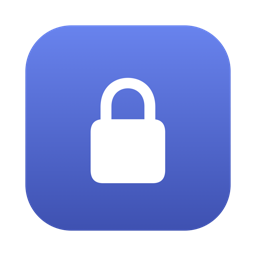
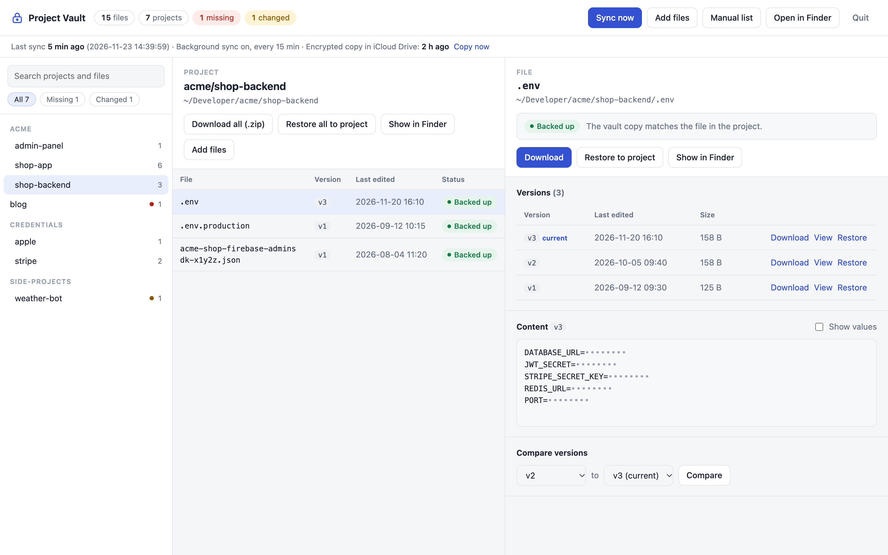
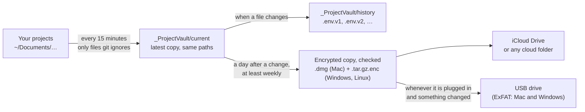
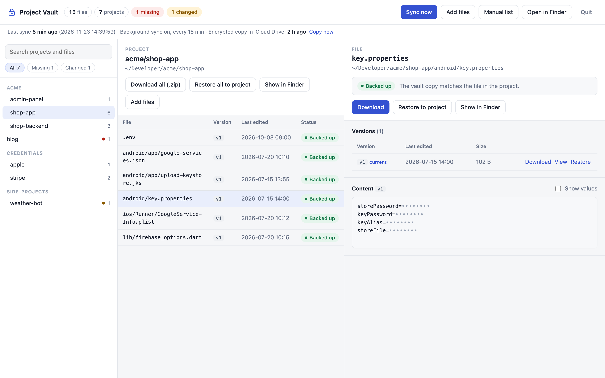
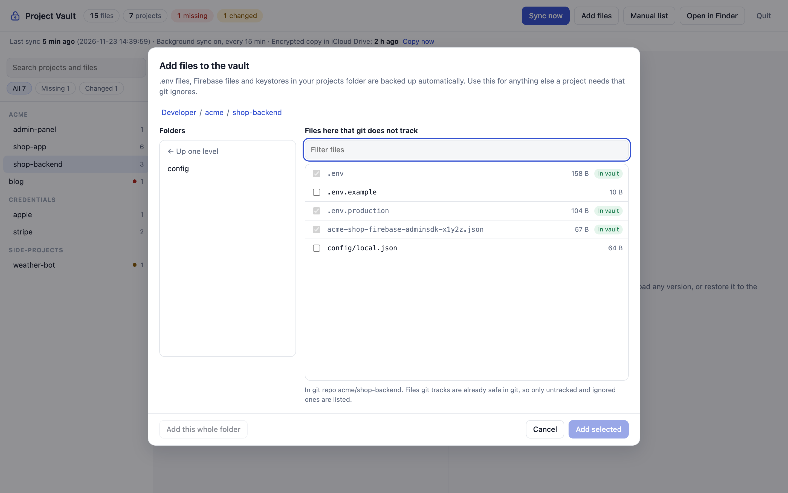
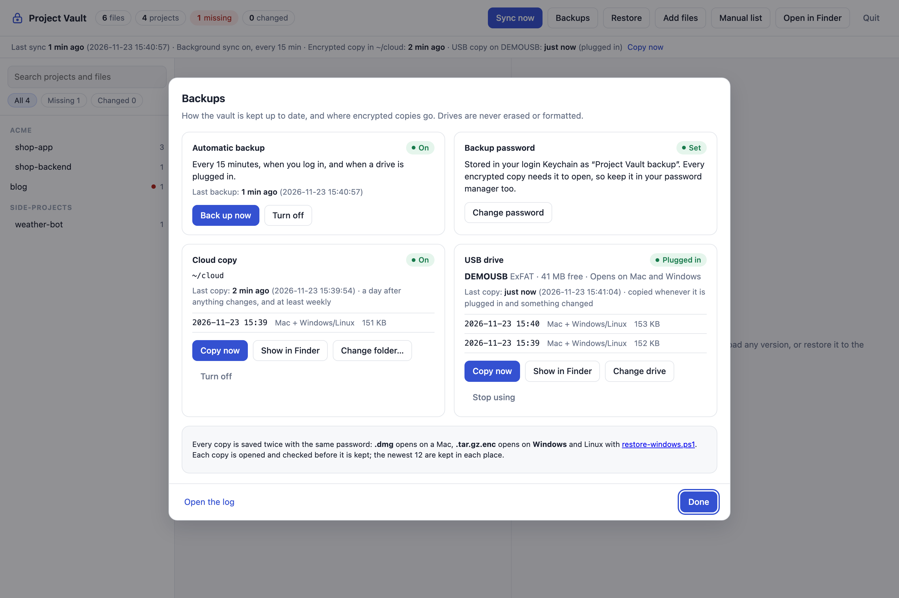

<div align="center">



# Project Vault

**Never lose a `.env` file or an Android keystore again.**

Project Vault backs up the files your projects need but git ignores (`.env` files,
Firebase configs, keystores, signing keys). It keeps every version of them, plus
encrypted copies in the cloud and on a USB drive that you can open even from
Windows, and it does all of this without you having to think about it.

[](#install)
[](src/vault)
[](src/vault_ui.py)
[](#install)
[](LICENSE)

[Install](#install) · [How it works](#how-it-works) · [The window](#the-project-vault-window) · [Commands](#commands) · [Getting files back](#getting-files-back) · [Security](#security) · [FAQ](#faq)

</div>

<br>

<picture>
  <source media="(prefers-color-scheme: dark)" srcset="docs/screenshot-dark.png">
  
</picture>

## Why

Every project has files that are in `.gitignore` on purpose: `.env`,
`google-services.json`, `key.properties`, the `.jks` you sign Android releases
with, an App Store Connect `.p8` key. They are not in git, so they exist on
exactly one disk.

Lose the laptop, delete the wrong folder, or overwrite a `.env` with the wrong
values, and they are gone. Losing an Android upload keystore can mean you can no
longer ship updates to your app.

Project Vault finds those files across all your projects, keeps every version,
and puts an encrypted copy somewhere safe. It changes nothing in your repos.

## Features

- **Finds the files on its own.** It scans your projects folder for `.env*`
  files, Firebase configs, keystores, `key.properties`, iOS signing files and
  more. It only takes files git does **not** track; tracked files are already safe in git.
- **Keeps every version.** Each change is saved as a new version (v1, v2, v3…).
  You can compare any two versions and restore any one of them.
- **Never deletes anything.** If a project folder disappears, its files stay in
  the vault, marked "source missing".
- **Keeps your folder layout.** `current/` mirrors your projects folder, so you
  always know where a file belongs.
- **Runs on its own.** A low-priority background job runs every 15 minutes and at login.
- **Encrypted copies off your Mac.** It saves AES-256 copies to iCloud Drive
  (or any cloud folder) and to a USB drive whenever it is plugged in. It opens
  each copy to check it before keeping it.
- **Recoverable without a Mac.** Every copy is saved as a `.dmg` for Macs *and*
  as a `.tar.gz.enc` that opens on Windows (one PowerShell command) and Linux.
- **Comes with a window.** You can browse, compare, download, restore and add
  files there. It runs only on your Mac, and values stay hidden until you ask to see them.
- **Restores with one command.** `vault restore acme/shop-app` puts every file
  back where it belongs.
- **Needs nothing extra.** It uses zsh, Python's standard library and tools
  built into macOS. It is about 2,800 lines you can read.

## How it works



What a file's history looks like:

| When | `current/…/.env` | `history/…/` |
|---|---|---|
| First backup | **v1** | |
| You edit `.env` | **v2** | `.env.v1_2026-09-12_0930` |
| You edit it again | **v3** | `.env.v1_…`, `.env.v2_2026-10-05_0940` |
| You delete the project | **v3** (kept, "source missing") | all of the above |

## Install

You need macOS and Xcode's command line tools, which provide git, clang and
Python 3. If you have used git on this Mac you already have them; otherwise run
`xcode-select --install`.

```bash
git clone https://github.com/zamansheikh/project-vault.git
cd project-vault
./install.sh
```

If your projects live somewhere other than `~/Documents`:

```bash
./install.sh --root ~/Developer
```

The installer:

| Installs | Where |
|---|---|
| The program | `~/Library/Application Support/ProjectVault/` |
| The `vault` command | `~/.local/bin/vault` |
| The background job (every 15 minutes, at login) | `~/Library/LaunchAgents/com.projectvault.sync.plist` |
| The **Project Vault** app, which opens the window | `~/Applications/Project Vault.app` |
| Your vault | `<projects folder>/_ProjectVault` |

It also runs the first backup. Then set up encrypted copies off your Mac (recommended):

```bash
vault offsite setup   # iCloud Drive, or a Google Drive / Dropbox folder
vault usb setup       # a USB drive, copied whenever it is plugged in
```

To update, run `git pull && ./install.sh` again. Your vault, its history and
your settings are kept. If the installer says `~/.local/bin` is not on your
`PATH`, it prints the one line that adds it.

> Built and tested on macOS 27. It relies on APFS disk images, `launchctl bootstrap` and
> zsh, so any recent macOS should work. Please open an issue if yours does not.

## What gets backed up

| | |
|---|---|
| **Automatically**, when git does not track them | `.env`, `.env.*`, `*.env`, `.dev.vars`, `.npmrc`, `*.tfvars`, `google-services.json`, `GoogleService-Info.plist`, `firebase_options.dart`, `*firebase-adminsdk*.json`, `serviceAccount*.json`, `service-account*.json`, `.runtimeconfig.json`, `credentials*.json`, `secrets*`, `key.properties`, `keystore.properties`, `*.jks`, `*.keystore`, `*.p8`, `*.p12`, `*.pem`, `*.mobileprovision` |
| **Never** | files git tracks; `*.example`, `*.sample`, `*.template`, `*.dist`; `local.properties`; `node_modules`, `build`, `dist`, `Pods`, `.dart_tool`, `.gradle`, `.next`, Unity `Library`, virtualenvs; worktree copies (`.worktrees`, `.claude`); files over 50 MB |
| **Your choice** | anything else (a `config/local.json`, a folder of certificates): add it in the window, or as a line in `extras.txt`. Use `exclude.txt` to skip something. |

Your vault folder:

```text
_ProjectVault/
├── current/          latest copy of every file, same paths as in your projects folder
├── history/          every older version: .env.v1_2026-09-12_0930, .env.v2_…
├── INDEX.md          every project, file, version and status (rebuilt on each sync)
├── extras.txt        extra files and folders to back up
├── exclude.txt       paths never to back up
├── offsite.conf      where encrypted copies go
└── logs/changes.log  one line per added, changed or restored file
```

## The Project Vault window

Open **Project Vault** from Launchpad or Spotlight, or run `vault ui`. It opens
in your browser, but it is served only from your own Mac.

<table>
<tr>
<td width="50%"></td>
<td width="50%"></td>
</tr>
<tr>
<td>Every file of a project, with its version, last edit and status. <code>KEY=value</code> files show only their keys until you tick <b>Show values</b>.</td>
<td><b>Add files</b> lists what git ignores in a project. Tick what the project needs and it is backed up from then on.</td>
</tr>
</table>




- **Backups menu.** Everything about keeping copies, in one place:
  - turn automatic backup on or off, or **Back up now**
  - set or change the backup password
  - cloud copy: **Use iCloud Drive** or **Choose a folder…**, then Copy now, Show in Finder, Turn off
  - USB drive: pick one of the plugged-in drives (its format, free space and
    whether Windows can read it are shown; drives are never erased), then Copy
    now, Show in Finder, Change drive, Stop using
- **Restore menu.** Every file that is missing from your projects in one list
  (tick and restore), and **Recover from this copy** to bring the vault back from
  an encrypted copy in the cloud or on the USB drive.
- **Status at a glance.** The top bar shows how many files are missing or
  changed, when the last backup and encrypted copies ran, and whether the
  background job is on.
- **Per file.** View any version, compare two versions, download any version,
  or restore it into the project.
- **Per project.** Download all of a project's files as a `.zip`, or restore them all at once.
- **Sync now**, **Copy now** (encrypted copy) and **Open in Finder** are one click away.

## Commands

| Command | What it does |
|---|---|
| `vault sync` | Back up now (it also runs by itself every 15 minutes) |
| `vault status` | Show what is new, changed or missing, without saving |
| `vault restore <path>` | Put a project's (or one file's) files back where they belong |
| `vault restore <file> --version N` | Restore an older version |
| `vault history <path>` | List a file's versions, or a project's files |
| `vault diff <file> [A] [B]` | Show what changed between two versions |
| `vault ui` | Open the window |
| `vault offsite setup` | Keep encrypted copies in iCloud Drive or another cloud folder |
| `vault usb setup` | Keep encrypted copies on a USB drive whenever it is plugged in |
| `vault offsite` / `vault offsite status` | Make encrypted copies now, everywhere set up / show where and when |
| `vault usb now` / `vault usb remove` | Copy to the USB drive now / stop using it (its copies are kept) |
| `vault offsite setup icloud` / `vault offsite setup <folder>` / `vault offsite remove` | Same as the window's buttons, without questions |
| `vault password` | Change the backup password |
| `vault recover <copy>` | Bring back files from an encrypted copy (`.tar.gz.enc` or `.dmg`); only adds what the vault is missing |
| `vault service` | Is the background job on? When did the last backup and copy run? |
| `vault stop` / `vault start` | Turn the background job off (it stays off after a restart) / on |
| `vault help` | Every command |

`<path>` is relative to your projects folder (`acme/shop-backend`, or
`acme/shop-backend/.env` for one file). It can also be relative to where you are:
`vault restore .` inside a project restores that project.

## Encrypted copies off your Mac

Set up either or both:

```bash
vault offsite setup   # a cloud folder: press Return for iCloud Drive → ProjectVault Backups
vault usb setup       # a USB drive: plug it in, pick it from the list
```

The first one you set up asks for **a password**. You type it in Terminal (twice)
and it is stored in your login Keychain as **Project Vault backup**, so the
background job can use it. It is never written to a file or passed on a command
line. **Save it in your password manager too:** without it, nobody can open the
copies, including you. Use standard keyboard characters so it also works on Windows.

| | Cloud folder | USB drive |
|---|---|---|
| **When a copy is made** | a day after anything in the vault changes, and at least weekly | as soon as it is plugged in, if anything changed since its last copy, and at least weekly |
| **Where** | `ProjectVault Backups` in the folder you chose | `ProjectVault Backups` on the drive |
| **Reminders** | the window and `vault service` show when a try failed | they also say when the USB copy is over two weeks old |

Every copy is the whole vault, including its history, saved in two formats with
the same password:

| File | Opens on | How |
|---|---|---|
| `ProjectVault-<date>.dmg` | macOS | double-click, type the password |
| `ProjectVault-<date>.tar.gz.enc` | Windows, Linux, macOS | [`tools/restore-windows.ps1`](tools/restore-windows.ps1), or `openssl` + `tar` |

Before a copy is kept, **both** files are opened with the password and compared
file by file. The newest 12 of each are kept (`KEEP=` in `offsite.conf`). A
`README-RESTORE.txt` next to them explains how to open them without Project Vault.

> **Your drive is never erased or formatted.** Project Vault only adds a
> `ProjectVault Backups` folder and leaves everything else on the drive alone, so
> you can use the drive you already carry. Drives formatted **ExFAT** or **FAT32**
> (the usual format for USB sticks and external SSDs) open on both Mac and Windows.
> Mac-format drives (APFS, Mac OS Extended) work too, but Windows can't read them.
> NTFS drives can't be used, because macOS cannot write to them.
>
> You can also name the drive instead of picking it from a list:
> `vault usb setup "My Drive"`.

## If your Mac is gone (Windows or Linux)

You need the backup password (from your password manager) and the newest
`ProjectVault-<date>.tar.gz.enc`. Get it from:
- **the USB drive** (plug it into the PC), or
- **iCloud Drive**: [iCloud for Windows](https://apps.microsoft.com/detail/9pktq5699m62)
  or [icloud.com/iclouddrive](https://www.icloud.com/iclouddrive) in a browser.

**On Windows 10 or 11**, install [Git for Windows](https://git-scm.com/download/win)
(it includes OpenSSL), download [`tools/restore-windows.ps1`](tools/restore-windows.ps1),
and in PowerShell:

```powershell
powershell -ExecutionPolicy Bypass -File restore-windows.ps1 "D:\ProjectVault Backups\ProjectVault-2026-11-23_140400.tar.gz.enc"
```

It asks for the password and unpacks into `%USERPROFILE%\ProjectVault-restore`.
Every file is in `_ProjectVault\current`, at the same path it had on the Mac.
Clone your projects on Windows, then add `-ProjectsFolder` and every `.env`,
keystore and config goes back into place:

```powershell
powershell -ExecutionPolicy Bypass -File restore-windows.ps1 "…\ProjectVault-….tar.gz.enc" -ProjectsFolder C:\code
```

Files that already exist are left alone unless you add `-Overwrite`.

**On Linux, or in Git Bash on Windows:**

```bash
openssl enc -d -aes-256-cbc -pbkdf2 -iter 600000 -md sha256 -in ProjectVault-<date>.tar.gz.enc | tar -xzf -
```

> Project Vault itself runs on macOS only. On Windows you can always get every
> file back and keep working; the automatic backups resume when you install
> Project Vault on a Mac again.

## Getting files back

**You deleted or re-cloned a project.**

```bash
vault restore acme/shop-app
```

**You broke a `.env`.**

```bash
vault history acme/shop-backend/.env
vault diff acme/shop-backend/.env 2 3
vault restore acme/shop-backend/.env --version 2
```

**The vault folder itself was deleted or damaged.** Click **Restore → Recover
from this copy** in the window, or:

```bash
vault recover "/Volumes/My Drive/ProjectVault Backups/ProjectVault-2026-11-23_153026.tar.gz.enc"
```

It adds every file and older version the vault is missing and never overwrites
anything. If the vault and the copy have different versions of a file, the
copy's is kept as `history/<name>.recovered_<date>`.

**Your Mac is lost, or you have a new one.** Open the newest
`ProjectVault-<date>.dmg` from iCloud Drive or the USB drive and type the
password. Copy the `_ProjectVault` folder inside it into your projects folder,
install Project Vault, clone your projects, and run `vault restore` for each
one. You can also copy single files straight out of `current/`; each copy
contains a `HOW TO RESTORE.txt` with these steps. No Mac at all? See
[If your Mac is gone](#if-your-mac-is-gone-windows-or-linux).

`restore` never overwrites a file silently. If the project has a different
copy, it asks first. With `--force`, or when you answer yes, your current
file is first saved in `history/` as `<name>.pre-restore_<date>`.

## Security

| Project Vault protects against | It does not protect against |
|---|---|
| A deleted, broken or re-cloned project | Someone who can log in to your Mac as you |
| An overwritten or wrong `.env` (every version is kept) | Secrets you never put in a file it watches |
| A lost, stolen or dead Mac, once encrypted copies are set up (recoverable on Windows too) | Losing the backup password **and** your Mac |

- **The vault folder** can only be opened by your macOS user (`700`). It is
  not encrypted on its own, so turn on **FileVault** (System Settings → Privacy &
  Security). Never put the vault inside a git repo; this repo's `.gitignore`
  blocks `_ProjectVault/`.
- **Encrypted copies** are made twice: macOS's own AES-256 disk image encryption
  (`.dmg`), and AES-256-CBC with a PBKDF2-SHA256 key (600,000 iterations) via
  OpenSSL (`.tar.gz.enc`). The password lives only in your login Keychain and in
  your password manager.
- **The window** listens on `127.0.0.1` only, behind a random key created each time it
  opens. It uses an `HttpOnly`, `SameSite=Strict` cookie, checks the `Host` header,
  requires a custom header on every change, and loads nothing from the internet.
  It stops after 15 idle minutes.
- **Nothing leaves your Mac** except the encrypted copies, and only if you run
  `vault offsite setup` or `vault usb setup`, only to the folder or drive you choose.
- **Spotlight** indexes the vault by default. To keep secrets out of search
  results, add the vault folder under System Settings → Spotlight → Search Privacy.

## Background job

```bash
vault service   # on or off, last backup, last cloud and USB copy, window open or closed
vault stop      # off, and stays off after a restart
vault start     # on again
```

It runs every 15 minutes, at login, and whenever a drive is plugged in (so a USB
copy starts right away).

Its log is `~/Library/Logs/ProjectVault/agent.log`. If the log ever says
`cannot read` or `could not write`, macOS blocked the job from a protected
folder. Add `~/Library/Application Support/ProjectVault/ProjectVaultAgent` under
**System Settings → Privacy & Security → Full Disk Access**.

## Configuration

| File | What it sets |
|---|---|
| `~/Library/Application Support/ProjectVault/config` | `ROOT` (your projects folder) and `VAULT` (the vault folder). Change them by running `./install.sh --root …` again. |
| `<vault>/extras.txt` | Extra files or folders to back up, one per line, relative to `ROOT` |
| `<vault>/exclude.txt` | Paths never to back up (for example third-party code that ships `.env` files) |
| `<vault>/offsite.conf` | `DEST=` (the cloud folder), `USB_UUID=` and `USB_NAME=` (the USB drive), `KEEP=` (copies to keep in each place; default 12) |
| Keychain item **Project Vault backup** | The encrypted copies' password |

## Uninstall

```bash
./uninstall.sh
```

This removes the program, the background job, the `vault` command and the app.
It **keeps** your vault, its encrypted copies and the Keychain password, and
tells you where they are.

## FAQ

<details>
<summary><b>Why not git-crypt, SOPS or a secrets manager?</b></summary>

They are great for sharing secrets with a team through git or a server. Project
Vault is for the files you deliberately keep out of git, across dozens of
personal and client projects, without changing a single repo or how you work.
You can use both.
</details>

<details>
<summary><b>Does it upload anything?</b></summary>

No. The only things that ever leave the vault folder are the encrypted copies,
written to the folder or USB drive you chose. The window talks only to your own Mac.
</details>

<details>
<summary><b>Does it see changes instantly?</b></summary>

No. It checks every 15 minutes. Run `vault sync`, or click **Sync now**, to back
up right away.
</details>

<details>
<summary><b>My projects are in more than one folder.</b></summary>

Point `--root` at a folder that contains all of them, such as your home folder.
Dependency, build and `Library` folders are always skipped. Use `exclude.txt`
for anything else you don't want scanned.
</details>

<details>
<summary><b>Linux or Windows?</b></summary>

You can **recover** everything on Windows or Linux: see
[If your Mac is gone](#if-your-mac-is-gone-windows-or-linux). The backup tool
itself runs on macOS only, because it uses launchd, the macOS Keychain and
`hdiutil`. A Windows version would need Task Scheduler and the Windows
Credential Manager instead; contributions are welcome.
</details>

## Development

```bash
zsh tests/smoke.sh
```

This runs `src/vault` against a throwaway folder and checks 46 things: what is
picked up and skipped, versions, missing sources, restores, lock recovery,
recovering from a copy, both encrypted formats (they must refuse a wrong password, and the `.tar.gz.enc` must
open with OpenSSL 3, as shipped with Git for Windows, using the same command as
the Windows script), and USB copies on an ExFAT disk image standing in for a
drive. It never touches your real vault, background job or login Keychain.

| Path | What it is |
|---|---|
| `src/vault` | The `vault` command (zsh) |
| `src/vault_ui.py`, `src/vault_ui.html` | The window's local server and page |
| `src/ProjectVaultAgent.c` | The small program launchd starts, so macOS permissions can go to it instead of `/bin/zsh` |
| `install.sh`, `uninstall.sh` | Install, update and remove |
| `tools/restore-windows.ps1` | Opens a `.tar.gz.enc` copy on Windows and puts files back into your projects |
| `assets/` | The app icon and the script that draws it |

## License

[MIT](LICENSE) © [Zaman Sheikh](https://github.com/zamansheikh)
